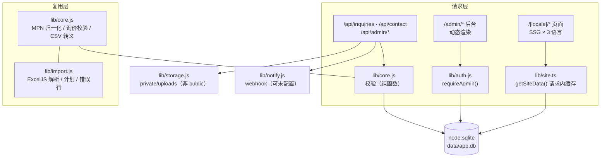

# 技术架构

## 1. 选型与取舍

| 层 | 选择 | 版本（锁定于 package-lock.json） | 为什么 |
| --- | --- | --- | --- |
| 框架 | Next.js App Router | 16.4.2 | 需要 `/zh` `/en` `/ru` 独立路由 + 静态化 + 同仓库 API；App Router 的 `generateStaticParams` 让三语页面构建期出静态页 |
| UI | React | 19.3.1 | 与 Next 16 配套 |
| 样式 | Tailwind CSS v4（`@tailwindcss/postcss`） | 4.3.3 | v4 用 `@theme` 直接把 token 写进 CSS，不再需要 JS 配置；设计变量集中在 `app/globals.css` 一处 |
| 动效 | GSAP + ScrollTrigger | 3.15.0 | 需要 pin + scrub + 精确 cleanup；CSS scroll-timeline 在 Safari 仍不可用 |
| 语言 | TypeScript（strict） | 5.9 | `tsc --noEmit` 进 CI；纯 ESM 的运行时代码（`lib/*.js`）手写 `.d.ts` 保证调用侧有类型 |
| 持久层 | `node:sqlite`（`DatabaseSync`） | Node 22.22.2 内置 | **判断依据**：本阶段只有 12 张表、单机部署、无横向扩容需求。用内置 SQLite 免掉原生编译（Windows 上 better-sqlite3 常因 MSVC 失败），也不必为一张询价单引入 PostgreSQL 运维 |
| 表格 | ExcelJS | 4.4.0 | 读写 xlsx、生成错误行工作簿；读取时能区分公式单元格并拒绝 |
| 后台 | 自建（签名 cookie + scrypt） | — | 见下节 |
| 字体 | `next/font`（Inter + IBM Plex Mono） | 构建期自托管 | 不依赖运行时第三方字体 CDN；西里尔字形随包提供 |

### 为什么没有用 Payload CMS

需求允许「评估 Payload + PostgreSQL」。评估后**不采用**，理由按权重排序：

1. **会引入第二套内容模型**。本项目的内容形态是「12 类固定集合 + 少量 key/value 配置」，用自建 schema + 通用集合 API 就能覆盖；Payload 带来自己的 collection 定义、自己的后台路由、自己的迁移工具，等于两套模型要长期对齐。
2. **部署面变大**。Payload 3 需要与 Next 同进程或独立服务 + 数据库迁移流程，本阶段是单机单进程交付，运维成本与收益不匹配。
3. **私有附件的权限边界更简单**。附件必须「只有登录后台的人能下」，自建路由里就是一次 `requireAdmin()` + `path.resolve` 边界检查；接入第三方 CMS 要额外确认它的 media 路由没有把文件暴露成公开 URL。
4. **不是永久结论**。当内容类型需要可视化建模、需要多人协作草稿与版本对比时，Payload 的收益会超过迁移成本；届时数据模型已按 `COLLECTIONS` 声明式描述（`lib/admin-schema.ts`），迁移路径是清楚的。

## 2. 目录与职责



| 文件 | 单一职责 |
| --- | --- |
| `lib/core.js` | 纯函数协议：MPN 归一化、品牌归一、询价校验、CSV 公式注入防护、导入行校验与 `planImport`。客户端表单、后台、导入、测试**共用同一份** |
| `lib/db.js` | 唯一的持久化入口；迁移（`PRAGMA user_version`）、种子、所有查询与事务 |
| `lib/auth.js` | scrypt 口令、HMAC 会话 cookie、限流键、IP 哈希、管理员引导 |
| `lib/storage.js` | 私有附件落盘、魔数校验、路径穿越防护 |
| `lib/notify.js` | 通知适配器；返回 `sent / failed / not_configured`，不假装成功 |
| `lib/import.js` | xlsx/csv 读取、模板、错误行工作簿 |
| `lib/i18n.ts` / `content/i18n/*.json` | 三语字典与路由助手 |
| `lib/site.ts` | 前台数据装配（含 `localizedField` 回退链） |
| `lib/admin-schema.ts` | 集合/字段声明，供后台表单动态渲染 |

## 3. 数据模型

```mermaid
erDiagram
  site_config { text key PK text value json text updated_at }
  brands { int id PK text slug UK text name text legal_name text logo_key text brand_color text website text categories text supply_relation text supply_note text internal_note int is_public }
  categories { int id PK text slug UK text name_zh text name_en text name_ru text blurb_zh }
  services { int id PK text slug UK int is_public int sort }
  faqs { int id PK int is_public int sort }
  team_roles { int id PK text scope int headcount int is_verified }
  warehouse_items { int id PK int is_public int sort }
  page_seo { text path PK text locale_zh_title text locale_en_title }
  parts { int id PK text external_id UK text brand text mpn text mpn_norm text package int moq }
  inquiries { int id PK text code UK text kind text status text internal_note text notification_status text ip_hash text dedupe_key }
  inquiry_items { int id PK int inquiry_id FK text mpn text mpn_norm int qty }
  attachments { int id PK int inquiry_id FK text stored_name text mime int bytes text sha256 }
  import_batches { int id PK text status int created int updated int failed }
  import_log { int id PK int batch_id FK text key text action }
  admin_users { int id PK text email UK text password_hash }
  audit_log { int id PK text actor text action text target }

  inquiries ||--o{ inquiry_items : "至少 1 行或 1 个附件"
  inquiries ||--o{ attachments : "最多 3 个 / 单个 ≤ 8MB"
  import_batches ||--o{ import_log : ""
```

`parts` 上的唯一约束：`external_id` 唯一；`brand + mpn_norm` 仅在 `external_id IS NULL` 时唯一（部分索引），因此「有外部 ID」和「无外部 ID」的数据不会互相误判。

## 4. 公开内容与内部数据的分界

这是本项目最容易出事的地方，因此用**查询投影**而不是「前端不显示」来保证：

| 数据 | 公开 API 是否可见 | 实现方式 |
| --- | --- | --- |
| 品牌名、法定名、标识、颜色、类目 | 是 | `listPublicBrands()` 的 SELECT 只投影这 7 列 |
| 供货关系 `supply_relation` / `supply_note` | 部分：仅聚合后的图例 | 品牌页只展示「已确认/寻源中/待确认」三类说明，不逐条披露具体品牌关系 |
| 内部备注 `internal_note` | **否** | 不在公开 SELECT 内，只在后台详情页出现 |
| 客户联系人 / 询价内容 | **否** | 仅 `/api/admin/*`，均先 `requireAdmin()` |
| 附件文件 | **否** | 落盘在 `private/uploads/`（不在 `public/` 下），下载必须走 `/api/admin/attachments/[id]`，且有审计记录 |
| 通知失败原因 | **否** | 只写 `inquiries.notification_status/detail`，后台可见 |

`tests/db.test.mjs` 里有一条断言专门检查「公开品牌投影里不含 internal_note / supply_note 字段」，防止后续有人加列时顺手 `SELECT *`。

## 5. 安全与限流

- 口令：`scrypt`（随机盐，存储格式 `scrypt$salt$hash`）；未知邮箱走等价的哈希计算，避免时序泄漏账号是否存在。
- 会话：HMAC-SHA256 签名的 HttpOnly cookie，8 小时过期，`SameSite=Lax`，生产环境 `Secure`；密钥不足 24 字符时生产环境直接拒绝启动会话。
- 限流：询价 6 次 / 10 分钟（按 IP 哈希滑动窗口，进程内）；后台登录同样受限。
- 上传：扩展名白名单 + 魔数嗅探（改名的 EXE 会被拒）+ 单文件 8MB / 最多 3 个 + 随机文件名 + 落盘在公开目录之外。
- 路径：`uploadPath()` 规范化分隔符后 `path.resolve`，越界即抛错（`tests` 未覆盖这条，靠代码审查 + 手动验证：早期版本用 `basename` 丢了 `2026-10/` 目录，已修）。
- 导出：CSV 单元格以 `= + - @ Tab CR` 开头时前置 `'`，并输出 UTF-8 BOM。
- 后台路由：`next.config.ts` 对 `/admin/:path*` 加 `X-Robots-Tag: noindex`；`robots.ts` 禁止抓取 `/admin` 与 `/api/`。

## 6. 渲染与性能策略

- 公开页面全部 SSG（3 语言 × 各页），后台与 API 动态。
- 指针与滚动的连续值**不进入 React 状态**：指针走 `gsap.quickTo` + 单个 rAF，滚动由 ScrollTrigger 直接写 transform / CSS 变量；React 只在「状态标签切换」这类低频事件上重渲染。
- 首屏三帧用 `next/image` 的 `priority`，其余图片懒加载；图片只允许本地路径（`remotePatterns: []`）。
- `prefers-reduced-motion` 时：hero 直接呈现稳定首帧、滚动驱动全部关闭、磁性按钮回退为普通按钮，业务功能不变。
